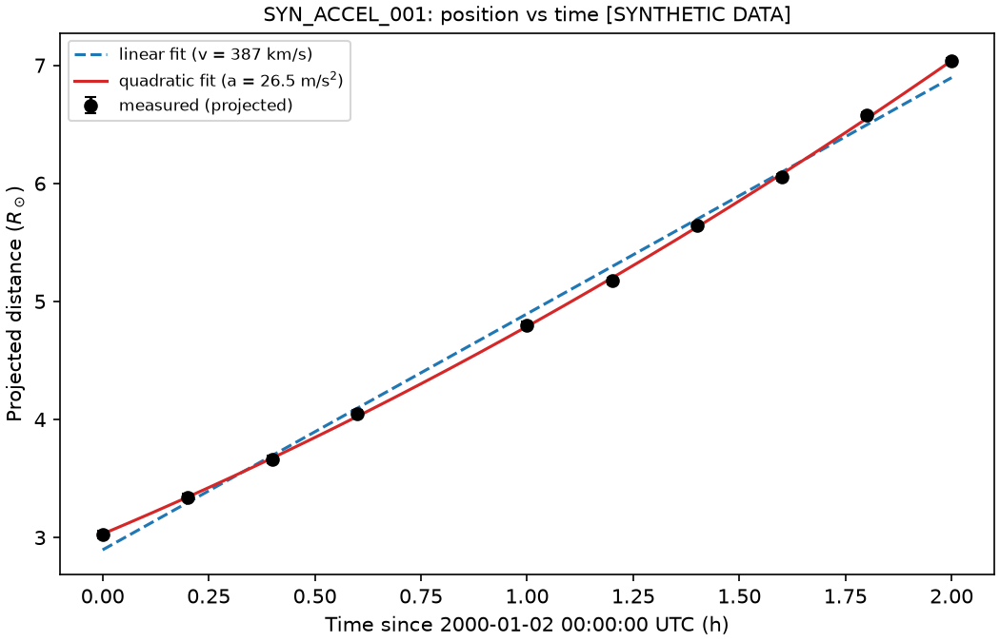
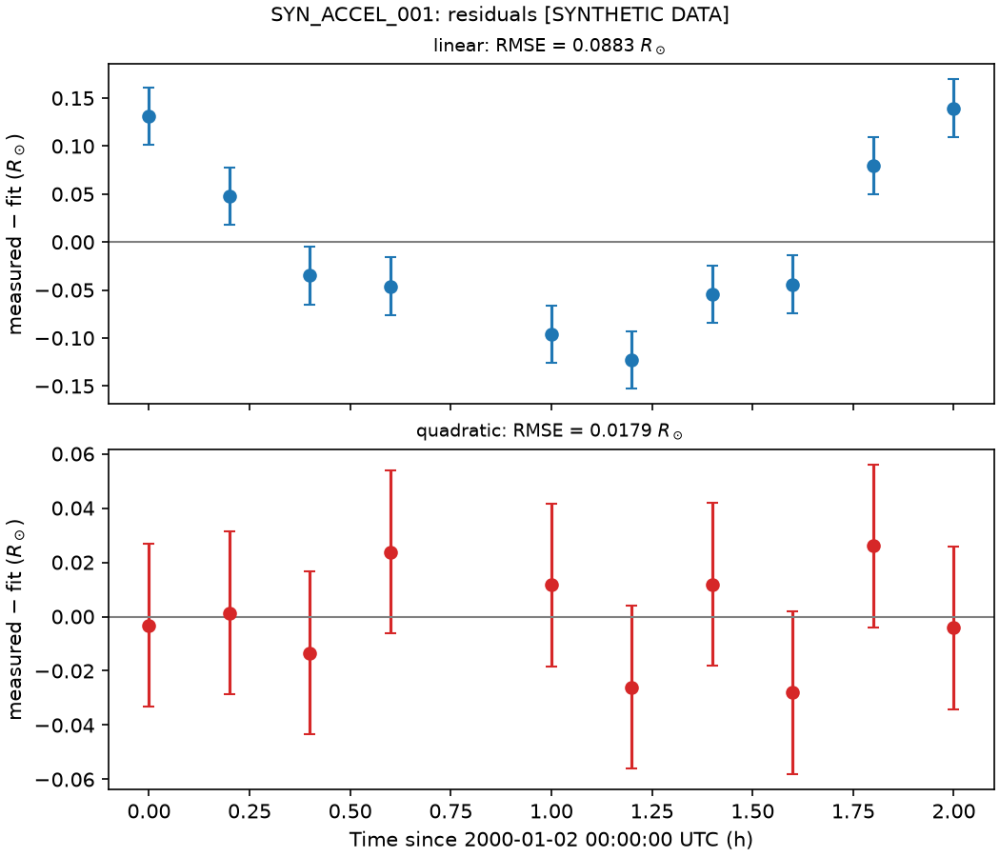
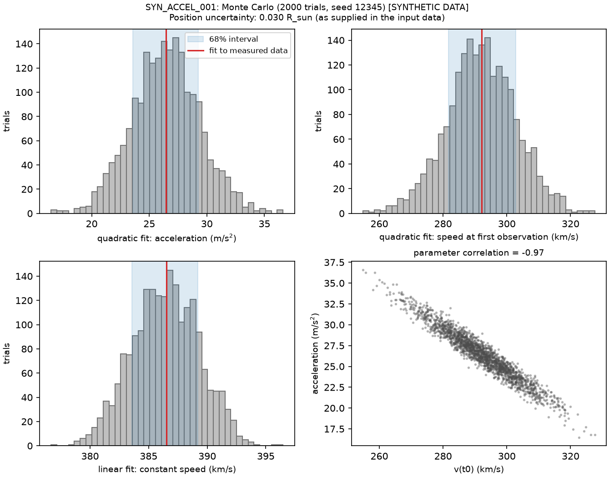
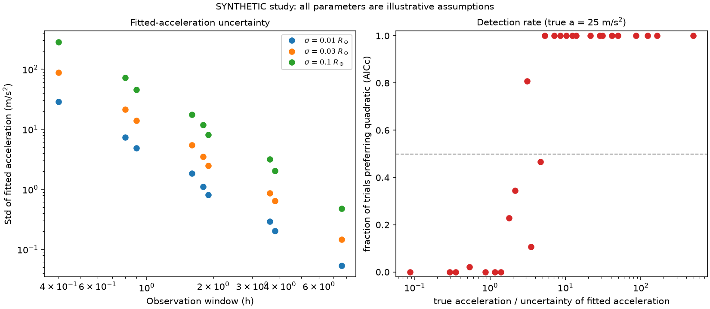

# CME kinematics and space weather analysis pipeline

a python toolkit for measuring and fitting the kinematics of coronal mass ejections (CMEs) from coronagraph position-time data, with historical solar-wind and geomagnetic data retrieval and a monte carlo uncertainty analysis.

**status:** the kinematics calculator (phase 1), the Monte Carlo uncertainty analysis (phase 5), and the OMNI data retrieval with window summaries (phase 3) are implemented. image-based measurement (phase 2) and the combined CME and space-weather analysis (phase 4) are planned.

## scientific problem

the leading edge of a CME, seen in coronagraph images such as SOHO/LASCO, traces a position-time curve. speed and acceleration estimated from that curve feed studies of CME propagation and space weather. differentiating noisy positions amplifies the noise, so the toolkit pairs finite differences with least-squares trajectory fits and keeps measurement uncertainty explicit throughout.

## my research background

based on 2025 research project through Talaria Research Institute "Coronal Mass Ejection Kinematics: Calculating Plasma Velocity and Acceleration"
using SciPy and Matplotlib to chart propagation edge and calculate the plasma kinematics through succesive imported images


## implemented and planned

| feature | status |
|---|---|
| CSV loading with explicit column mapping and strict validation | implemented |
| interval velocity and acceleration with uncertainty propagation | implemented |
| linear and quadratic trajectory fits, AICc and BIC comparison | implemented |
| plots and CSV and text export | implemented |
| Monte Carlo uncertainty analysis | implemented |
| acceleration sensitivity study (synthetic) | implemented |
| OMNI hourly solar-wind and geomagnetic retrieval with caching | implemented |
| per-window summaries of near-Earth conditions | implemented |
| human-guided image measurement | planned |
| CDAW catalog adapter | planned |
| combined CME and space-weather analysis | planned |

the toolkit does not detect CMEs, predict geomagnetic storms, or establish causation.

## setup used

i develop on windows 11 with python 3.11 in a virtual environment, working in powershell.

```powershell
py -3.11 -m venv .venv
.venv\Scripts\Activate.ps1
python -m pip install --upgrade pip
pip install -e ".[dev]"
```

## running

each script writes to a results or data folder and prints a report. these are the commands i use:

```powershell
python scripts\make_sample_data.py
python scripts\run_analysis.py data\sample\synthetic_cme_observations.csv --out-dir results\sample
python scripts\run_monte_carlo.py data\sample\synthetic_cme_observations.csv --out-dir results\sample
python scripts\run_sensitivity_study.py --out-dir results\sample
python scripts\fetch_omni.py --start 2003-10-28 --stop 2003-11-01
python scripts\summarize_event_window.py --reference-time 2003-10-28T11:30:00Z --label example
python -m pytest -v
```

the reference time in the last analysis command is an arbitrary illustration, not a catalog value.

## input format

| column | required | meaning |
|---|---|---|
| `event_id` | yes | groups rows into one CME |
| `timestamp` | yes | ISO 8601 in UTC (a time without a zone is taken as UTC) |
| `position_solar_radii` | yes | projected leading-edge distance in solar radii, above 0 |
| `instrument` | yes | for example `LASCO_C2` |
| `position_uncertainty_solar_radii` | no | 1-sigma, in solar radii, above 0 |
| `source_image` | no | image identifier |
| `data_origin` | no | for example `synthetic` or `manual_measurement` |

rows must be in chronological order. invalid data raises an error that lists every problem with its CSV line number. rows are never dropped or reordered silently. other column names are handled through an explicit `column_map`, not by guessing.

## outputs

- `processed_observations.csv`: fits and residuals for each observation
- `finite_differences.csv`: interval velocities and accelerations
- `fit_summary.csv` and `summary.txt`: fitted parameters, errors, and model comparison
- `plots/`: position, velocity, acceleration, and residual plots
- `monte_carlo_summary.csv`, `monte_carlo_report.txt`, and Monte Carlo plots
- `acceleration_study.csv` and its plot
- `data/processed/`: OMNI tables and window summaries, each with a metadata JSON file

## methods

**kinematics.** the solar radius is 695,700 km (IAU nominal) and time is in seconds since the first observation. interval velocity is the position difference over the time difference, assigned to the interval midpoint. acceleration applies the same difference to successive velocities. each difference uses its own time step, so irregular spacing is handled. uncertainties are propagated from the positions, and acceleration is propagated from the three positions it depends on, because neighbouring velocities share a point.

**trajectory fits.** the models are `r = r0 + v t` and `r = r0 + v0 t + a t^2 / 2`. both are linear in their parameters, so i solve weighted least squares directly. with uncertainties the covariance is `(X^T W X)^-1`. without them it is scaled by `RSS/(n-k)`. a model comparison by AICc counts a difference of more than 2 as a preference, and BIC is reported alongside. no comparison is made below 5 points. in the quadratic model, `v0` is the speed at the first observation.

**Monte Carlo uncertainty.** independent Gaussian noise with the stated per-point uncertainty is added to the measured positions, both models are refit for each trial (2000 by default, seed recorded), and percentile intervals are taken from the refitted values. the same trials give how often AICc prefers the quadratic model. the spread agrees with the analytic covariance, which is tested.

**sensitivity study.** a grid of position uncertainty, point count, and cadence is run on a synthetic trajectory with a known acceleration. for evenly spaced points the uncertainty of the fitted acceleration scales linearly with the position uncertainty and with the inverse square of the observation window. a second panel shows how often the quadratic model is preferred against the ratio of true acceleration to its fitted uncertainty.

**OMNI retrieval.** hourly data come from the dataset `OMNI2_H0_MRG1HR` through the CDAWeb HAPI server. the variables are flow speed, Bz in GSM coordinates, Kp, and Dst. behaviour confirmed against the live server:

- the server reports HAPI version 2.0, which uses `time.min` and `time.max`. the client picks the names from the reported version.
- parameters have to be requested in the dataset's own order. a different order returns an error message inside an HTTP 200 response labelled as csv, so every response body is checked and not only the status.
- a reply of "no data for time range" is treated as an empty result.
- time stamps are the midpoint of each hourly average, so the hour from 00:00 to 01:00 is stamped 00:30.
- Kp is stored as Kp times 10 and is converted back. the 3-hourly value repeats in each hourly row.
- fill values come from the dataset metadata and become NaN. missing hours stay as explicit NaN rows and nothing is interpolated or replaced.
- raw responses are cached with a sidecar file holding the request URL, retrieval time, parameters, and a SHA-256 of the response. transient network failures are retried with backoff, and requests are spaced by one second.
- coverage is reported per variable, including the last valid time stamp.

**window summaries.** an analysis window is defined by a reference time, a start offset, and a duration (defaults of 12 h and 120 h, both illustrative). for each window i report the Dst minimum, Kp maximum, Bz minimum, the number of hours below a Bz threshold (default -5 nT), and the speed maximum and mean, always with the valid-hour count. a statistic is withheld when less than a minimum fraction of the window is valid (default 0.8). both settings are assumptions and are written into the output. Kp is also counted in 3-hour blocks, since hourly Kp rows are not independent samples. no association between a CME and a disturbance is inferred in this step.

## validation

- synthetic trajectories with known velocity and acceleration are recovered to numerical precision.
- fits agree with `scipy.optimize.curve_fit`.
- in a Monte Carlo test, reported 1-sigma intervals cover the true value about 68% of the time.
- the model comparison rarely claims acceleration for constant-velocity data.
- the OMNI client is tested offline with a fake session and synthetic fixtures, including the error-inside-HTTP-200 case, the no-data case, retries, caching, and fill handling.
- window summaries are tested for withheld statistics, half-open windows, and inconsistent Kp blocks.
- the test suite (83 tests at the time of writing) is run with `python -m pytest -v`.

## sample results

the sample data are synthetic (`data_origin = synthetic`) and are not CME observations. the position uncertainty of 0.03 solar radii is an illustrative assumption.






## interpretation and limitations

- positions are projected plane-of-sky distances, so speeds are lower bounds on the three-dimensional speed.
- point-to-point accelerations are dominated by noise at realistic uncertainties. a better quadratic fit does not show physical acceleration, because projection, mis-picked edges, and correlated or underestimated errors can produce curvature.
- constant acceleration across the whole field of view is a simplification.
- only measurement noise is modelled. systematic and model errors are not included, and the Monte Carlo errors are independent.
- OMNI propagates measurements to the bow shock nose, so the time stamps do not include travel from there to the magnetosphere.
- recent OMNI data lag by weeks. the solar-wind variables end earlier than Kp and Dst, so a recent window can have Dst but no Bz or speed.
- Dst is listed with provisional and quick-look periods in the variable description. i did not check how the years between the final and provisional ranges are labelled.
- in a test window around the late-october 2003 storms, 59 of 96 hourly speed values came back as fill values. i did not investigate the cause. it shows that a window statistic can rest on little data, which is why the valid count is reported with every number.
- a disturbance inside an analysis window does not show that a given CME caused it. other CMEs, high-speed streams, and corotating interaction regions also drive geomagnetic activity.

## data sources and attribution

the OMNI hourly data are from NASA's Space Physics Data Facility, accessed through the CDAWeb HAPI service in october 2026. Dst comes from WDC Kyoto as distributed in OMNI, and Kp is taken as listed in the dataset.

- dataset: Papitashvili, N. E. and King, J. H., "OMNI Hourly Data" [data set], NASA Space Physics Data Facility, https://doi.org/10.48322/1shr-ht18 (accessed october 2026)
- reference: King, J. H. and Papitashvili, N. E., Solar wind spatial scales in and comparisons of hourly Wind and ACE plasma and magnetic field data, J. Geophys. Res., 110, A02104, 2005
- acknowledgement: i acknowledge use of NASA/GSFC's Space Physics Data Facility's CDAWeb service, and OMNI data.

downloaded data are not committed to this repository. the planned sources are SOHO/LASCO (through JHelioviewer and Helioviewer) and the CDAW CME catalog. i will add their attribution wording when i use them.