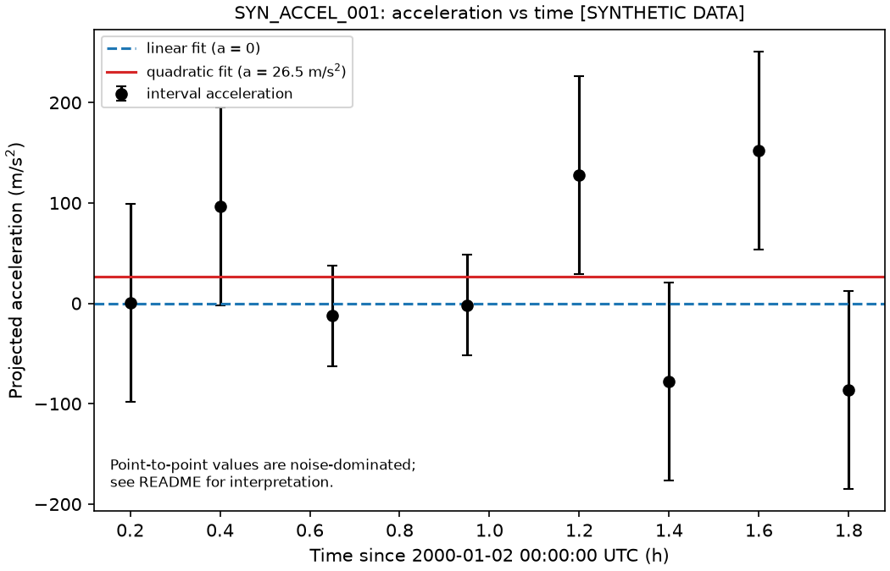

# CME Kinematics and Space Weather Analysis Pipeline

python toolkit for measuring and fitting the kinematics of coronal mass ejections (CMEs)
from coronagraph position-time data

**currently implemented phase 1 only**

## scientific problem

a CME's leading edge, seen in coronagraph images (e.g. SOHO/LASCO), traces a
position-time curve. from it we estimate speed and acceleration, which feed into
studies of CME propagation and space weather. differentiating noisy positions
amplifies the noise, so this toolkit pairs finite differences with least-squares
trajectory fits and keeps measurement uncertainty explicit.

## my research background

based on 2025 research project through Talaria Research Institute "Coronal Mass Ejection Kinematics: Calculating Plasma Velocity and Acceleration"
using SciPy and Matplotlib to chart propagation edge and calculate the plasma kinematics through succesive imported images

## implemented vs planned

| feature | status |
|---|---|
| CSV loading with explicit column mapping and strict validation | implemented |
| interval velocity and acceleration with uncertainty propagation | implemented |
| linear (constant velocity) and quadratic (constant acceleration) fits | implemented |
| model comparison (AICc, BIC) with cautions | implemented |
| plots and CSV/text export | implemented |
| monte carlo uncertainty analysis | planned |
| solar-wind / geomagnetic data retrieval (OMNI) | planned |
| human-guided image measurement | planned |
| CME / space-weather analysis | planned |

the toolkit does not detect CMEs, predict geomagnetic storms, or establish causation.

## install (Windows, PowerShell)

```powershell
py -3.11 -m venv .venv
.venv\Scripts\Activate.ps1
python -m pip install --upgrade pip
pip install -e ".[dev]"
```

## run

```powershell
python scripts\make_sample_data.py
python scripts\run_analysis.py data\sample\synthetic_cme_observations.csv --out-dir results\sample
python -m pytest -v
```

## input format

| column | required | meaning |
|---|---|---|
| `event_id` | yes | groups rows into one CME |
| `timestamp` | yes | ISO 8601, UTC (no zone is assumed UTC) |
| `position_solar_radii` | yes | projected leading-edge distance, solar radii, > 0 |
| `instrument` | yes | e.g. `LASCO_C2` |
| `position_uncertainty_solar_radii` | no | 1-sigma, solar radii, > 0 |
| `source_image` | no | image identifier |
| `data_origin` | no | e.g. `synthetic`, `manual_measurement` |

rows must be in chronological order. invalid data raises an error listing every problem with
its CSV line number; nothing is silently dropped or reordered.

## outputs

`processed_observations.csv` (fits and residuals per observation), `finite_differences.csv`,
`fit_summary.csv`, `summary.txt`, and `plots/` (position, velocity, acceleration, residuals).

## methods

- solar radius: 695,700 km (IAU nominal). time in seconds since the first observation.
- interval velocity: `v = dr/dt` between consecutive points, assigned to the interval midpoint.
  acceleration: the same difference applied to successive velocities. irregular spacing is handled
  because each difference uses its own time step.
- uncertainty propagation assumes independent position errors; acceleration is propagated from the
  three positions it depends on (neighbouring velocities share a point).
- fits: weighted linear least squares, `r = r0 + v t` and `r = r0 + v0 t + a t^2 / 2`. with
  uncertainties, covariance is `(X^T W X)^-1`; without, it is scaled by `RSS/(n-k)`.
- model comparison: AICc (difference of more than 2 counts as a preference), BIC reported. Not
  assessed below 5 points.

## validation

- synthetic trajectories with known velocity/acceleration are recovered to numerical precision.
- fits agree with `scipy.optimize.curve_fit`.
- monte carlo test: reported 1-sigma intervals cover the true value about 68% of the time.
- model comparison rarely claims acceleration for constant-velocity data.
- run `python -m pytest -v`.

## sample results

sample data are **synthetic** (`data_origin = synthetic`); they are not CME observations. The
uncertainty (0.03 solar radii) is an illustrative assumption.




## interpretation and limitations

- positions are **projected** plane-of-sky distances; speeds are lower bounds on 3D speeds.
- point-to-point accelerations are noise-dominated with realistic uncertainties. a better quadratic
  fit does not prove physical acceleration (projection, mis-picked edges, correlated or
  underestimated errors can mimic curvature).
- in the quadratic model, `velocity_km_s` is the speed at the first observation, not a launch speed.
- constant acceleration over the whole field of view is a simplification.
- only measurement noise is modeled; systematic and model errors are not.

## data sources and attribution

phase 1 uses no external data. planned sources: SOHO/LASCO (via JHelioviewer / Helioviewer), the
CDAW CME catalog, and NASA OMNIWeb/CDAWeb. check each provider's current acknowledgement wording
before adding real data, and do not commit large downloads.
